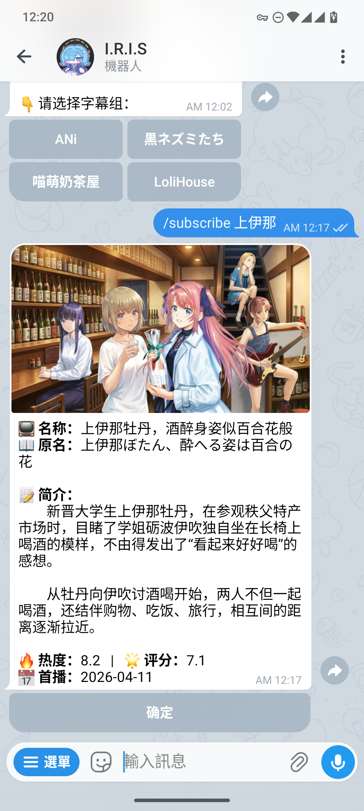
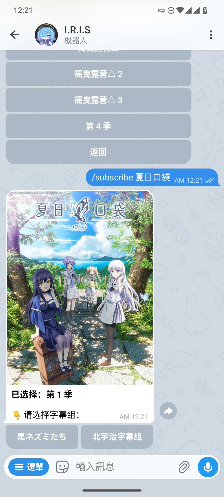
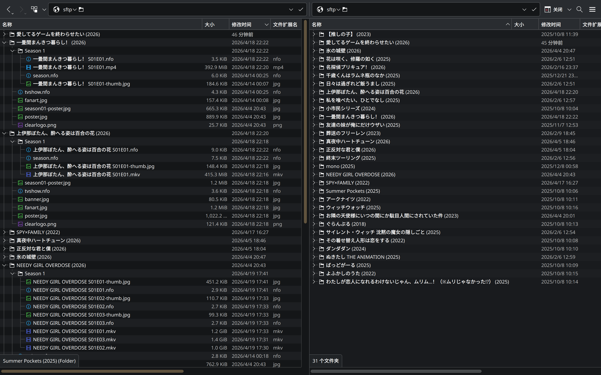

<div align="center">


# Shinban Sync

[](https://opensource.org/licenses/Apache-2.0)


帮你把订阅的新番下下来，改好名字，放进你的 Emby、Jellyfin 或 Plex 媒体库。

[怎么用](docs/使用.md) · [配置](docs/配置.md) · [Docker](docs/docker.md) · [NAS](docs/nas.md)

</div>

## Features

- 网页上搜番、选季、选字幕组，也可以用 Telegram 的 `/subscribe`
- 到点自动同步。可以通过网页设置定时，也可以配置文件手动设置cron
- 半路订阅也会按开播日期把落下的集数补上
- 下载交给 Aria2，归档支持本地目录、SFTP 和 OpenList
- Docker：直接使用 GitHub Actions 发布到 GHCR 的镜像，多架构支持
- Unraid、群晖 DSM、飞牛 OS 的 Compose 和配置样例见 [NAS 部署](docs/nas.md)

## Screenshot

<table>
  <tr>
    <td></td>
    <td></td>
  </tr>
  <tr>
    <td></td>
    <td></td>
  </tr>
</table>

## 本地配置

装好 [Poetry](https://python-poetry.org/) 和 Python 3.13 之后：

```bash
cp config.example.yml config.yml
poetry install
poetry run shinban-sync web -c config.yml
```

浏览器打开 <http://127.0.0.1:3325>。这一条命令会同时提供接口和网页。第一次启动会自动构建界面，本机需要已安装 pnpm。不想自己装的话，可以直接用 [GitHub 打好的镜像](docs/docker.md)。

如果只想同步一轮、然后退出：

```bash
poetry run shinban-sync sync -c config.yml
```

## 协议

[Apache License 2.0](LICENSE)。Copyright 2026 wiseCirno。
